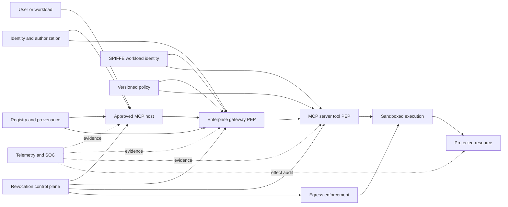

# Enterprise MCP Security Architecture

An architecture diagram is a hypothesis, not a security result. A defensible
enterprise MCP platform must show that every executable path carries the right
identity, tenant, audience, purpose, policy, artifact, isolation, telemetry,
revocation, and ownership evidence—and that the system behaves safely when a
control plane is stale, unavailable, or compromised.

## Course thesis

After this course, you should be able to design, compare, and prove an
enterprise MCP platform in which every path to a protected tool is
identity-bound, tenant-scoped, policy-enforced at the tool boundary,
provenance-gated, isolated, observable, revocable, resilient to control-plane
failure, and governed by owned evidence rather than a diagram or gateway claim.

## Learning objectives

You will be able to:

1. distinguish MCP protocol roles from enterprise platform control planes;
2. place preventive, detective, recovery, and governance controls at the trust
   boundaries where they can enforce an outcome;
3. derive user, workload, tenant, audience, resource, and delegated authority
   from authenticated application state;
4. explain why gateway authorization cannot replace authorization at the MCP
   tool and protected-resource boundary;
5. design registry, provenance, policy, identity, isolation, egress,
   observability, and revocation planes with explicit owners and failure modes;
6. compare centralized, distributed, direct, and hybrid enforcement without
   confusing lower component count with lower risk;
7. enumerate paths and bypasses, inject control-plane failures, and evaluate
   labelled valid and adversarial requests with auditable denominators; and
8. produce a reviewable architecture record without treating review success as
   production authorization.

### Prerequisites

Complete Courses 1–22 or be comfortable with MCP 2026-07-28, OAuth resource
servers, workload identity, policy enforcement, supply-chain provenance,
sandboxing, OpenTelemetry, incident response, and revocation convergence.

## Standards snapshot: October 2026

This course targets MCP `2026-07-28`. That revision uses a stateless protocol
core: each request carries its protocol version and capabilities. The host still
owns coordination, consent, context aggregation, and server isolation; each
client still has a one-to-one relationship with one server. Stateless transport
does not make identity, authorization, durability, audit, or revocation
stateless application concerns.

For HTTP authorization, an MCP server is an OAuth resource server. Current MCP
requirements include protected-resource metadata, authorization-server
discovery, resource indicators, audience validation, issuer-aware authorization
response validation, least-privilege scope challenges, and authorization on
every request. Dynamic Client Registration remains for compatibility but is
deprecated in favor of Client ID Metadata Documents. Enterprise-Managed
Authorization is a stable extension for centrally provisioned access; it does
not remove resource-server authorization.

The enterprise design also draws on:

- NIST SP 800-207 and 800-207A for resource-focused zero trust, workload
  identity, policy enforcement points, and cloud-native multi-location access;
- NIST CSF 2.0 for continuous Govern, Identify, Protect, Detect, Respond, and
  Recover outcomes;
- NIST AI RMF and the Generative AI Profile for risk ownership and
  trustworthiness concerns that extend beyond conventional access control;
- CISA Zero Trust Maturity Model 2.0 for identity, devices, networks,
  applications/workloads, data, visibility/analytics, automation, and
  governance maturity;
- SPIFFE/SPIRE for attested, short-lived workload identities and trust domains;
- SLSA, Sigstore, and in-toto for artifact and provenance verification; and
- OpenTelemetry for correlated traces, metrics, and logs.

These frameworks describe outcomes and mechanisms. None certifies a particular
MCP deployment by name.

## The central authority boundary

```text
model / agent
  proposes a route, tool, policy change, architecture, or remediation

trusted application
  authenticates identities
  derives tenant and resource ownership
  validates protocol and capability contracts
  evaluates policy
  verifies provenance and runtime revision
  authorizes and executes effects
  records observable evidence
  reconciles failure and revocation
```

Prompt text, tool descriptions, registry metadata, role names, trace baggage,
model confidence, and signed-but-stale documents are inputs—not authority.

## Protocol architecture versus platform architecture

The MCP specification defines host, client, and server roles. An enterprise
platform adds control planes around them.

| Concern | Protocol role | Enterprise control plane |
| --- | --- | --- |
| Connection and context | Host/client | approved host estate, device posture, session policy |
| Capabilities | Host/client/server declarations | contract registry, compatibility tests, downgrade policy |
| User authorization | Host and OAuth client | identity provider, authorization server, consent/EMA policy |
| Resource authorization | MCP server | gateway PEP plus tool/resource PEP and policy decision service |
| Server discovery | Host/client | governed registry, ownership, lifecycle, provenance |
| Workload identity | Not granted by a server name | SPIFFE/SPIRE, cloud workload identity, mTLS |
| Execution | MCP server | sandbox, workload runtime, secrets broker, egress policy |
| Evidence | Implementation concern | OpenTelemetry, decision logs, protected-resource audit, SIEM |
| Revocation | Implementation concern | registry, host caches, tokens, sessions, tasks, egress, control epochs |
| Governance | Outside wire protocol | ownership, risk acceptance, exceptions, ADRs, tests, runbooks |

## Reference architecture



The gateway and server are independent policy enforcement points. The gateway
can normalize transport, reject invalid audiences, rate-limit, and add defense
in depth. The server still owns tool-specific action, resource, tenant, purpose,
and side-effect authorization because it is closest to the effect.

### One request, end to end

1. The application authenticates the user and device/session. It does not read
   identity or tenant from a prompt.
2. The host selects an approved server and capability contract from governed
   registry state. Discovery does not grant permission.
3. The client obtains a resource-bound token for the canonical MCP server URI.
4. The gateway validates transport, issuer, audience, expiry, scopes, tenant
   binding, rate limit, protocol version, and current policy/revocation epoch.
5. The MCP server repeats the checks relevant to its boundary and authorizes the
   exact tool, resource, tenant, purpose, and requested effect.
6. The runtime verifies that the running artifact matches the admitted registry
   digest and provenance result.
7. The tool executes in the required isolation tier with explicit filesystem,
   network, secret, CPU, memory, and time limits.
8. Egress permits only resolved destinations required by the authorized effect.
9. Traces and decisions record IDs, digests, policy/revision, reasons, latency,
   and outcomes without raw tokens, secrets, or unnecessary customer content.
10. The protected resource or another independent oracle records whether the
    effect occurred. Server self-report is not sufficient.

## Control planes and their contracts

### 1. Host and client plane

The host is a security boundary, not merely a UI shell. It should:

- keep full conversation history away from servers unless explicitly needed;
- create one isolated client per server;
- validate every request's protocol version and capabilities;
- bind server selection to governed registry identity;
- minimize context and credentials per call;
- surface meaningful consent or use enterprise-managed policy;
- bound calls, concurrency, cost, deadlines, retries, and cancellation; and
- prevent one server's content from changing another server's permissions.

### 2. Identity plane

Keep user identity, workload identity, and delegated authority distinct.

- User identity comes from the enterprise IdP and authenticated session.
- Workload identity comes from an attested runtime identity such as an
  X.509-SVID, not from a pod name or HTTP header supplied by a caller.
- Delegated authority is resource- and audience-bound and must be a subset of
  the parent authority.
- Tenant is derived from authenticated organizational state and resource
  ownership, then checked again at every effect boundary.
- Prefer short-lived, automatically rotated credentials. X.509-SVIDs avoid the
  replay characteristics of bearer JWTs where mTLS is practical.

SPIFFE trust domains are trust roots, not business tenants. Federation permits
verification across domains; it does not automatically authorize access.

### 3. Authorization and policy plane

Separate policy decisions from enforcement.

- Policy decision points evaluate typed principal, action, resource, context,
  tenant, purpose, policy version, and lifecycle facts.
- Policy enforcement points exist at the gateway and tool/resource boundary.
- Policy administration publishes reviewed, signed, versioned policy.
- Policy information points provide authenticated attributes with freshness and
  source semantics.

OPA/Rego and Cedar are common policy technologies. OPA supports signed bundles,
decision IDs, bundle revisions, and decision logs. Cedar models principal,
action, resource, and context and validates policies against a schema. Either
can be used safely or unsafely. A central policy engine does not help if one
route bypasses its enforcement point or if inputs are caller-controlled.

Default policy for sensitive effects should be deny on unavailable, stale,
invalid, or ambiguous identity/policy. For low-risk reads, a reviewed degraded
mode may use a current local policy cache and durable audit buffer. State the
allowed operations, cache age, expiry, reconciliation, and kill switch.

### 4. Registry and supply-chain plane

A registry entry should carry stable server identity, owner, lifecycle state,
supported protocol/capability contract, tenant scope, artifact digest,
provenance, SBOM, security result, policy version, update time, and revocation
revision.

At admission and runtime, verify:

- immutable artifact digest;
- signed provenance envelope;
- subject digest equals the artifact;
- trusted builder identity and source repository;
- recognized build type and external parameters;
- required SLSA expectations or verification summary;
- SBOM and vulnerability policy;
- capability contract and schema compatibility; and
- active lifecycle and current revocation state.

A signature proves who signed a statement. It does not prove freshness,
correctness, tenant authority, safety, or that the signer should be trusted.

### 5. Runtime isolation and egress plane

Choose an isolation tier from the workload risk, not convenience.

| Tier | Example | Appropriate use |
| --- | --- | --- |
| process/container | restricted container, seccomp, AppArmor/SELinux | reviewed code with bounded data and effects |
| sandboxed container | gVisor/Kata-style boundary | third-party or higher-risk server code |
| microVM/VM | dedicated kernel and stronger tenant separation | untrusted code or strong customer isolation |
| dedicated cluster/account | separate control and data plane | hard multi-tenancy or regulatory boundary |

Kubernetes namespaces are administrative scopes, not automatically hard tenant
boundaries. Use RBAC, default-deny NetworkPolicy with a supporting CNI, Pod
Security Admission, quotas, storage separation, workload identity, node or
control-plane isolation, and sandboxing as required. Verify that the selected
CNI and runtime actually enforce the declared controls.

Egress policy should validate names and every resolved address, block metadata
and internal ranges by default, bind authorization to the connection, constrain
DNS, and prevent credential forwarding to unintended audiences.

### 6. Observability and evidence plane

OpenTelemetry provides traces, metrics, logs, and baggage. Those signals support
correlation; they are not an authorization channel.

Record as appropriate:

- request, trace, operation, attempt, task, server, tool, resource, and tenant
  identifiers;
- authenticated principal and workload identity references—not raw secrets;
- validated argument or effect digest;
- artifact, policy, registry, and revocation revisions;
- authorization decision, reason code, and decision ID;
- approval and evidence IDs;
- bounded retry, cancellation, cost, and latency fields; and
- independently observed effect and terminal state.

Minimize and redact prompt, tool, and customer content. Keep sensitive forensic
originals in a purpose-bound evidence store rather than a general telemetry
index.

### 7. Revocation and resilience plane

Revocation is distributed convergence, not a database flag. Consumers can
include registry bindings, host caches, gateways, workload identities, access
tokens, sessions, queued tasks, sandbox workloads, policy caches, and egress
controls.

Publish a monotonic revision, require every control point to observe it, and
verify that affected authority cannot produce forbidden effects. Plan for lost
responses, duplicate events, stale caches, region loss, queue redelivery, and
restart. Reconcile unknown outcomes before retrying.

## Architecture alternatives

| Pattern | Strength | Principal risk | Suitable when |
| --- | --- | --- | --- |
| direct host-to-server | few hops, clear ownership | duplicated security plumbing and inconsistent policy | small estate with mature server teams |
| centralized gateway only | uniform ingress controls | gateway becomes ambient authority and server trusts a bypassable upstream decision | never as the only effect-boundary authorization |
| distributed enforcement | local context and failure isolation | policy drift, inconsistent evidence, larger operational burden | teams can own common libraries and conformance |
| hybrid gateway + tool PEP | shared transport controls plus resource-local authority | coordination and versioning complexity | most enterprise remote MCP estates |
| dedicated tenant planes | strongest isolation and blast-radius control | cost and fleet complexity | hostile tenants, regulated workloads, high-impact tools |

The lab compares a gateway-only baseline with hybrid enforcement. The baseline
blocks adversarial traffic only by making the whole architecture ineligible,
which also blocks valid work. A safe architecture must preserve both security
and useful compliant service.

## Failure-mode matrix

| Failure | Unsafe reaction | Defensible reaction |
| --- | --- | --- |
| identity unavailable | trust cached prompt claims | deny sensitive work; use only explicitly bounded current offline identity policy |
| policy service unavailable | fail open | use valid signed cache within TTL or deny; record degraded state |
| registry compromised | accept signed registry response | verify artifact/provenance outside the registry and stop on mismatch |
| gateway compromised | assume every downstream request is trusted | server repeats audience, tenant, action, resource, and policy checks |
| server compromised | accept server's “blocked” response | sandbox/egress constrain effects; protected resource supplies outcome evidence |
| telemetry unavailable | perform high-risk work invisibly | deny high risk; permit reviewed low-risk mode only with durable local evidence |
| revocation lag | average the consumer revisions | require every mandatory consumer to reach the required revision |
| region loss | mint global break-glass tokens | use tested regional failover with scoped identity, policy, registry, and evidence |

## Governance and ownership

Every component and flow needs more than a team name. Record:

- accountable owner and operational on-call;
- supported tenants, data classes, purposes, and regions;
- trust domain and identity issuer;
- current artifact, policy, and control revision;
- positive, negative, boundary, outage, and recovery tests;
- evidence locations and retention policy;
- incident, revocation, and recovery runbooks;
- SLOs and error budgets;
- exception owner, compensating controls, expiry, and removal test; and
- architecture decision record and material-change triggers.

Automated review may make a manifest eligible for human review. A signed human
architecture receipt may promote it to an approved reference design. Neither
receipt authorizes a runtime tool call, production deployment, cross-tenant
access, or risk exception.

## Evaluation model

Use labelled cases with independent expected outcomes.

### Positive cases

- valid tenant read;
- valid high-impact write with full evidence;
- low-risk read during a telemetry outage with a bounded local audit buffer;
- gateway compromise contained by tool-boundary enforcement.

### Negative and failure cases

- wrong tenant or audience;
- missing scope or undeclared capability;
- unknown tool or unapproved route;
- wrong runtime artifact or unverified provenance;
- stale policy or revocation revision;
- identity, policy, registry, or revocation outage;
- compromised server;
- high-impact work without telemetry; and
- gateway or sandbox bypass.

### Metrics

| Metric | Definition | Direction |
| --- | --- | --- |
| attack block rate | labelled adversarial cases blocked / all labelled adversarial cases | higher |
| valid-work success rate | labelled valid cases allowed / all labelled valid cases | higher |
| decision accuracy | cases matching expected result / all labelled cases | higher |
| path coverage rate | protected paths satisfying every required control / all enumerated protected paths | higher |
| evidence coverage rate | populated owner/evidence/test/runbook fields / all required evidence fields | higher |
| minimum independent enforcers | fewest distinct authorization/tenant PEPs on any protected path | normally at least two for high-impact effects |

Report counts with rates. A perfect block rate can be achieved by denying every
request; valid-work success exposes that failure. A perfect path rate says
nothing if the inventory omitted a bypass, so compare diagrams with runtime
routes, network state, service discovery, and traces.

## Practical lab

From the repository root:

```bash
uv run python curriculum/advanced/23-enterprise-mcp-security-architecture/lab.py
uv run --extra contributor pytest -q tests/test_course_23_enterprise_architecture.py
```

The lab uses common libraries already pinned by the repository:

- `cryptography` Ed25519 for a real tamper-evident architecture manifest;
- `networkx` to enumerate all simple entrypoint-to-resource paths;
- OpenTelemetry SDK for review evidence; and
- Python dataclasses for deterministic, inspectable contracts.

It is offline and credential-free. HMAC keys and Ed25519 seeds are fixtures for
teaching; production keys belong in a KMS/HSM-backed signing service with
rotation, access control, and audit.

### Scenario

Acme and Beta use one enterprise MCP support platform. A host calls a remote
support server through a gateway. The server executes ticket operations in a
sandbox and reaches a protected ticket ledger. Identity, policy, registry,
telemetry, egress, and revocation are distinct owned planes.

You will:

1. build and verify a signed architecture manifest;
2. enumerate every protected path and inspect its controls;
3. compare a gateway-only baseline with hybrid enforcement;
4. execute valid tenant work;
5. inject tenant, audience, scope, artifact, policy, and revision faults;
6. simulate identity, policy, registry, server, gateway, and telemetry failure;
7. calculate metrics with explicit populations;
8. record a non-authoritative model recommendation;
9. produce and consume an exact, expiring human architecture approval; and
10. confirm that the resulting catalog record still grants no runtime authority.

## Notebook

Open `enterprise_architecture.ipynb` from this course directory. It imports the
canonical `lab.py` rather than copying security logic. Read the interpretation
cells before modifying each failure injection. The final exercises ask you to
add a second protected resource, a regional failover path, and a time-bounded
policy-cache exception without widening authority.

## Production tool map

| Need | Common options | Verify before adoption |
| --- | --- | --- |
| OAuth/OIDC and EMA | enterprise IdP/authorization server, MCP SDK authorization support | issuer, audience, resource, step-up, client registration, revocation |
| workload identity | SPIFFE/SPIRE, cloud workload identity | attestation source, trust domain, rotation, federation, key custody |
| policy | OPA/Rego, Cedar/Verified Permissions, cloud IAM | schema, input authority, bundle signature, revision, decision logs, fail mode |
| registry and provenance | MCP Registry-compatible service, Sigstore/cosign, SLSA, in-toto | immutable subject, builder/source expectations, lifecycle, cache invalidation |
| runtime | Kubernetes, sandboxed runtimes, microVM platforms | actual boundary, Pod Security, seccomp, storage, node/control-plane isolation |
| gateway/mesh | Envoy-based gateways, service mesh, cloud API gateways | bypass paths, identity propagation, mTLS, policy version, header trust |
| egress | NetworkPolicy-capable CNI, egress proxy/gateway, cloud firewall | DNS rebinding, metadata blocking, resolved IP, credential stripping |
| telemetry | OpenTelemetry Collector and SDKs, SIEM/SOC tooling | semantic fields, redaction, backpressure, durable buffer, independent effects |
| delivery | GitOps and admission control | signed policy/config, separation of duties, rollback, drift detection |
| resilience | multi-region services, queues, durable workflows | RTO/RPO, duplicate delivery, stale state, unknown outcomes, drills |

Technology selection follows requirements and operating capability. A service
mesh, gateway, policy engine, or SIEM is not a control until traffic and failure
tests demonstrate that it enforces the intended outcome.

## Review checklist

- [ ] Inventory every host, client, server, extension, tool, resource, prompt,
      task, identity, datastore, and external destination.
- [ ] Mark trust boundaries, data classes, tenants, purposes, and regions.
- [ ] Verify user and workload identity separately.
- [ ] Bind OAuth tokens to canonical resources and validate issuer/audience.
- [ ] Enforce tool/resource authorization at the effect boundary.
- [ ] Enumerate all runtime paths and test bypasses.
- [ ] Verify artifact bytes and provenance outside the registry trust domain.
- [ ] Select isolation and egress controls from workload risk.
- [ ] Define fail-closed or explicitly bounded degraded behavior per plane.
- [ ] Version policy, registry, capability, and revocation state.
- [ ] Correlate evidence without treating trace context as authority.
- [ ] Assign owners, tests, runbooks, recovery objectives, and expiry to every
      exception.
- [ ] Measure valid work as well as adversarial blocking.
- [ ] Test restart, stale state, duplicate events, region failure, and recovery.
- [ ] Keep architecture approval separate from deployment and runtime approval.

## Exercises

1. **Resource-local enforcement:** remove tool authorization from the MCP server.
   Explain why the gateway's policy is insufficient and repair the path.
2. **Hard tenancy:** redesign Acme and Beta for dedicated control planes. List
   the additional cost, operational, evidence, and recovery responsibilities.
3. **Policy outage:** define a signed-cache degraded mode for `tickets.read`.
   Specify cache TTL, allowed actions, audit durability, expiry, and revocation.
4. **Regional failure:** add a second region and demonstrate that failover does
   not accept stale policy, registry, identity, or revocation state.
5. **Registry compromise:** move provenance verification to an independent
   admission service and design the root-of-trust rotation procedure.
6. **Exception:** create a time-bounded exception for one legacy server. Bind it
   to tenant, artifact, exact missing control, compensating tests, owner, expiry,
   and removal criteria.
7. **Architecture regret:** compare direct, gateway-only, distributed, and
   hybrid patterns using control exposure, valid-work success, path coverage,
   failure domains, operating cost, and recovery complexity.

## Claim-to-proof map

| Claim | Prose | Executable proof |
| --- | --- | --- |
| architecture manifest is tamper-evident | registry/governance sections | real Ed25519 verification and mutation tests |
| every protected path is controlled | reference architecture and checklist | NetworkX path enumeration plus missing-control/bypass tests |
| gateway is not ambient authority | alternatives and authorization sections | gateway-only baseline fails; gateway compromise remains contained |
| tenant/audience/scope/capability bind each request | request sequence | focused negative request tests |
| runtime artifact matches admitted provenance | registry section | digest/provenance gates and compromise cases |
| critical control planes fail closed | failure matrix | identity/policy/registry/revocation outage tests |
| observability failure is risk-sensitive | observability section | high-risk deny and low-risk buffered-read cases |
| evaluation preserves useful work | metrics section | explicit adversarial and valid denominators |
| model output grants no authority | central boundary | non-authoritative recommendation record |
| architecture approval is exact and single use | governance section | signed receipt, replay, mutation, expiry, and optimistic-version tests |
| review is not production authorization | governance section | every review/catalog record fixes `production_authorized=False` |

## Authoritative references

- [MCP 2026-07-28 architecture](https://modelcontextprotocol.io/specification/2026-07-28/architecture)
- [MCP 2026-07-28 authorization](https://modelcontextprotocol.io/specification/2026-07-28/basic/authorization)
- [MCP 2026-07-28 release](https://blog.modelcontextprotocol.io/posts/2026-07-28/)
- [MCP Enterprise-Managed Authorization](https://blog.modelcontextprotocol.io/posts/enterprise-managed-auth/)
- [NIST SP 800-207: Zero Trust Architecture](https://csrc.nist.gov/pubs/sp/800/207/final)
- [NIST SP 800-207A: Cloud-Native Multi-Location Zero Trust](https://csrc.nist.gov/pubs/sp/800/207/a/final)
- [NIST CSF 2.0](https://www.nist.gov/cyberframework)
- [NIST AI Risk Management Framework](https://www.nist.gov/itl/ai-risk-management-framework)
- [NIST AI 600-1: Generative AI Profile](https://doi.org/10.6028/NIST.AI.600-1)
- [CISA Zero Trust Maturity Model 2.0](https://www.cisa.gov/resources-tools/resources/zero-trust-maturity-model)
- [SPIFFE standards](https://spiffe.io/docs/latest/spiffe-specs/)
- [OPA signed bundles and configuration](https://www.openpolicyagent.org/docs/configuration)
- [OPA decision logs](https://www.openpolicyagent.org/docs/management-decision-logs)
- [Cedar policy language](https://docs.cedarpolicy.com/)
- [SLSA v1.2 artifact verification](https://slsa.dev/spec/v1.2/verifying-artifacts)
- [Sigstore/cosign verification](https://docs.sigstore.dev/cosign/verifying/verify/)
- [Kubernetes multi-tenancy](https://kubernetes.io/docs/concepts/security/multi-tenancy/)
- [Kubernetes Pod Security Admission](https://kubernetes.io/docs/concepts/security/pod-security-admission/)
- [OpenTelemetry signals](https://opentelemetry.io/docs/concepts/signals/)
